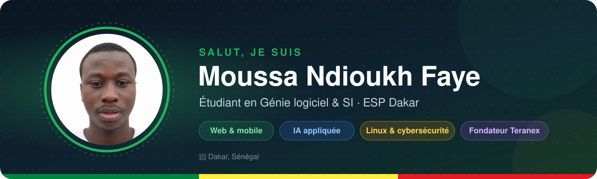
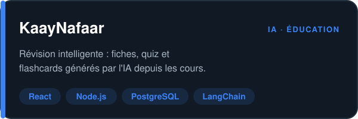
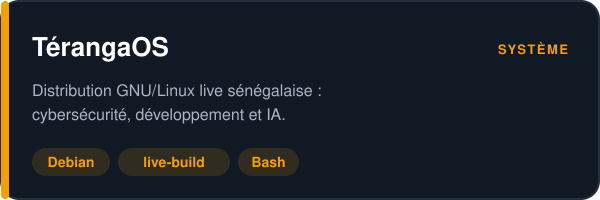
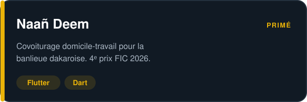
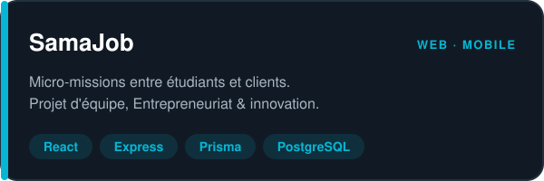
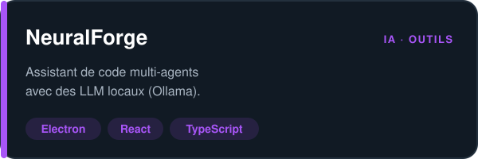
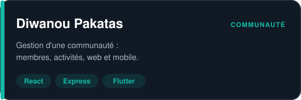

  

  
  
  

  

## À propos

Étudiant en **3ᵉ année de licence Génie logiciel et systèmes d'information** à l'**École Supérieure Polytechnique de Dakar (ESP/UCAD)**, je conçois des applications web et mobiles pour des problèmes concrets : réviser ses cours, sécuriser le foncier, se déplacer en banlieue, gérer une association. Ces projets se retrouvent dans **Teranex**, mon projet d'entreprise.

- En L3 GLSI, je prépare un **master en informatique**
- Je m'intéresse à l'**IA appliquée à l'éducation**, aux **systèmes d'information** et à la **cybersécurité**
- J'apprends l'architecture logicielle, Docker et les LLM en local

## Distinctions

<table>
  <tr>
    <td align="center" width="33%"><b>4ᵉ prix</b> Force-N Innovation Challenge 2026 avec Naañ Deem</td>
    <td align="center" width="33%"><b>HCIA-Datacom</b> Huawei Talent Online 2025</td>
    <td align="center" width="33%"><b>IA pour tous</b> FORCE-N · UN-CHK 2025</td>
  </tr>
</table>

## Projets phares

  
  
  
  
  
  
  
  

<b>Projets académiques (ESP)</b> — cliquer pour afficher

 

| Projet | Description | Stack |
| :-- | :-- | :-- |
| [Gestion de bibliothèque](https://github.com/Moussa-Ndioukh-Faye/Projet_java_biblio) | Bibliothèque municipale en programmation orientée objet | Java · Maven |
| [Gestionnaire de notes](https://github.com/Moussa-Ndioukh-Faye/Projet_java_dev_mobile) | Application Android avec persistance locale | Java · Android |
| [TP JavaFX + JDBC](https://github.com/Moussa-Ndioukh-Faye/tp14_poo_javafx) | Interface FXML connectée à MySQL | JavaFX · MySQL |
| [ActuSen](https://github.com/Moussa-Ndioukh-Faye/Actusen_site_actualite) | Site d'actualités avec administration et rôles | PHP · MySQL |
| [SenTransport](https://github.com/Moussa-Ndioukh-Faye/SenTransport) | Lignes de bus Dakar Dem Dikk et statistiques | React · Flask |
| [Gestion des étudiants](https://github.com/Moussa-Ndioukh-Faye/Projet-langage-c-gestion_etudiant) | Étudiants, classes, matières et notes en console | C |
| [Parrainage ESP](https://github.com/Moussa-Ndioukh-Faye/projet_Arphan_streamlit) | Appariement parrain-filleul entre étudiants | Python · Streamlit |
| [Services réseaux avancés](https://github.com/Moussa-Ndioukh-Faye/TP_Reseau_avances) | Mise en place de SSH, clés, SCP, tunnels | Linux · SSH |

## Technologies

    
    
  

## Statistiques

  
  

  

  

  

## Activité récente

<!--START_SECTION:activity-->
1. 🎉 Merged PR [#3](https://github.com/Moussa-Ndioukh-Faye/Moussa-Ndioukh-Faye/pull/3) in [Moussa-Ndioukh-Faye/Moussa-Ndioukh-Faye](https://github.com/Moussa-Ndioukh-Faye/Moussa-Ndioukh-Faye)
2. 🎉 Merged PR [#38](https://github.com/Moussa-Ndioukh-Faye/Sen_Parcelle/pull/38) in [Moussa-Ndioukh-Faye/Sen_Parcelle](https://github.com/Moussa-Ndioukh-Faye/Sen_Parcelle)
3. 💪 Opened PR [#38](https://github.com/Moussa-Ndioukh-Faye/Sen_Parcelle/pull/38) in [Moussa-Ndioukh-Faye/Sen_Parcelle](https://github.com/Moussa-Ndioukh-Faye/Sen_Parcelle)
4. 💪 Opened PR [#3](https://github.com/Moussa-Ndioukh-Faye/Moussa-Ndioukh-Faye/pull/3) in [Moussa-Ndioukh-Faye/Moussa-Ndioukh-Faye](https://github.com/Moussa-Ndioukh-Faye/Moussa-Ndioukh-Faye)
5. 🎉 Merged PR [#2](https://github.com/Moussa-Ndioukh-Faye/Moussa-Ndioukh-Faye/pull/2) in [Moussa-Ndioukh-Faye/Moussa-Ndioukh-Faye](https://github.com/Moussa-Ndioukh-Faye/Moussa-Ndioukh-Faye)
<!--END_SECTION:activity-->

<i>« Dalal ak diam » — bienvenue sur mon GitHub</i>

